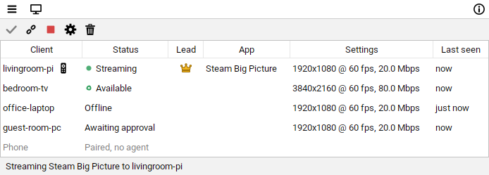
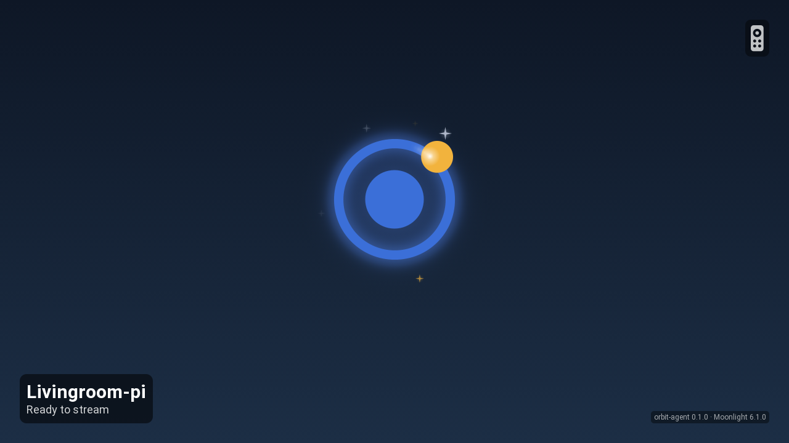
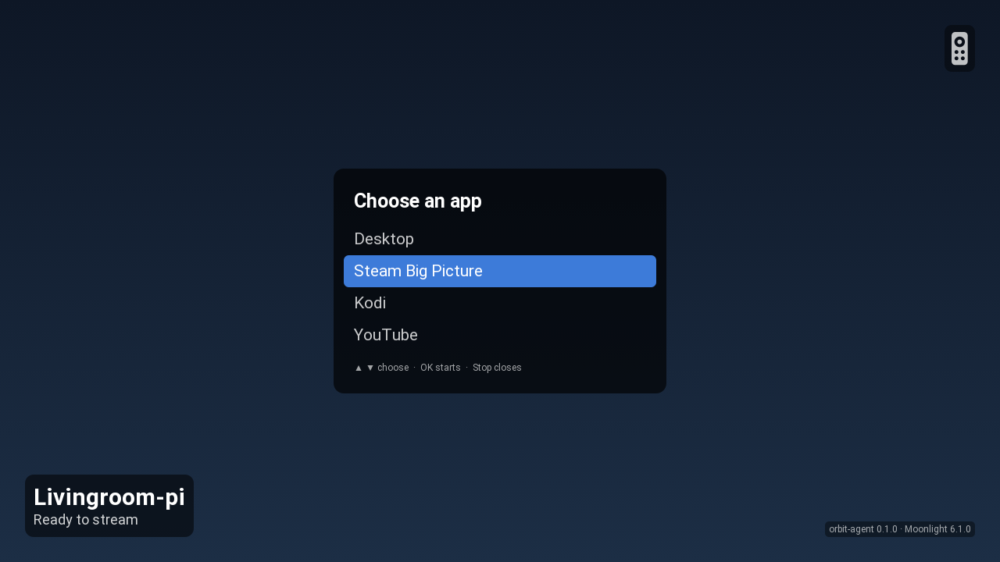
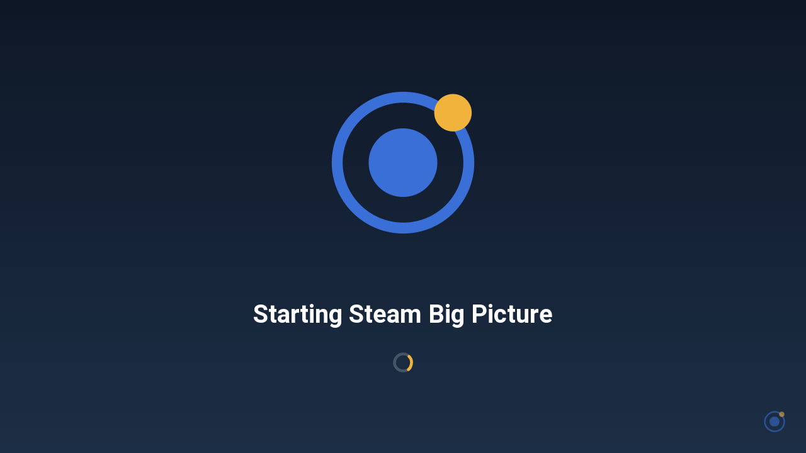
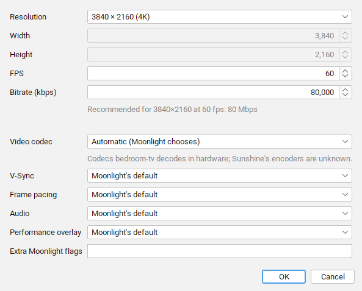
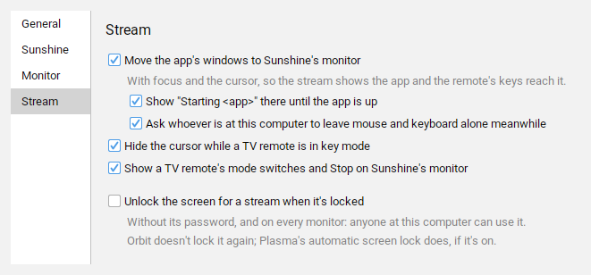

# Orbit

[](https://github.com/luftburen1/orbit/actions/workflows/ci.yml)

**Start and control [Moonlight](https://moonlight-stream.org) streams from your
[Sunshine](https://github.com/LizardByte/Sunshine) host.**

Orbit extends Moonlight with control from the host: start, stop and manage streams on clients that have no one at
them, such as a TV box or a Raspberry Pi by the TV. Moonlight still does all the streaming; Orbit decides when, what
and where.

<picture>
  <source media="(prefers-color-scheme: dark)" srcset="docs/screenshots/main-dark.png">
  
</picture>

> **Status: early preview (0.x).** Orbit is used daily on one setup: KDE Plasma on the host and a Raspberry Pi 5 on a
> text console. The display features (resolution matching, window placement, monitor power) need KDE Plasma on the
> host. The Windows agent has only been tested in a VM, and the host doesn't run on Windows yet. Some behaviour has
> only been tested against fakes, not real hardware.

## Contents

- [Why Orbit](#why-orbit)
- [Features](#features)
- [Requirements](#requirements)
- [Build](#build)
- [Set up](#set-up)
- [Using Orbit](#using-orbit)
- [TV remote and HDMI-CEC](#tv-remote-and-hdmi-cec)
- [Configuration](#configuration)
- [Troubleshooting](#troubleshooting)
- [License](#license)

## Why Orbit

Sunshine and Moonlight follow NVIDIA's GameStream design: you sit at the client, with a phone, a TV box or a laptop
and a controller, and the client starts the stream. That makes sense:

- **The client knows what it can show:** its resolution, refresh rate, the video codecs it can decode, and HDR.
- **Clients are often hard to reach:** they move between networks and sit behind routers. The host is the stable
  machine, so clients call it.
- **Sunshine can't start a stream on a client.** A stream only exists because a client asked for it.

That works well when someone sits at the client. It works less well for a screen nobody operates. Moonlight still
expects someone there to open it, find the host, enter the pairing PIN, pick an app and dismiss error screens.

Orbit turns the control around. You run everything from the host, and the network and Sunshine work exactly as
before:

```
 Client (TV box)                          Host (your PC)
 ┌───────────────┐  1. agent connects    ┌───────────────┐
 │ Orbit agent   │ ────────────────────▶ │ Orbit host    │
 │               │  2. "start Desktop    │               │
 │               │ ◀──────────────────── │               │
 │               │      at 1080p60"      │               │
 │ moonlight     │  3. Moonlight asks    │ Sunshine      │
 │ stream …      │ ────────────────────▶ │               │
 └───────────────┘     for the stream    └───────────────┘
```

1. The **agent** on the client finds the host on the local network (mDNS) and connects to it. The client needs no
   open port.
2. The **host** sends commands over that connection: pair, start or stop a stream, apply new stream settings.
3. The agent runs Moonlight, which asks Sunshine for the stream as usual. To Sunshine it's an ordinary Moonlight
   client.

## Features

**On the host** (a desktop app with a tray icon, on the Sunshine machine):

- Lists every client with its status, app, stream settings and when it was last seen.
- Approves new clients and pairs them with Sunshine: it enters the PIN for you.
- Starts any Sunshine app on a client, stops it, and changes its settings while it streams.
- Lists Moonlight clients without an agent (a phone, say) so you can pair or unpair them.
- Keeps a stream from quitting another client's app: Sunshine runs one app at a time.
- Asks before a stop that would quit an app with unsaved work.

On **KDE Plasma** the host also:

- switches the streamed monitor to the client's resolution and back
- moves the app's windows to the streamed monitor, so they show up on the TV and not on your desk
- shows a "Starting <app>" screen on the TV while the app starts
- turns the streamed monitor off while nothing streams
- can unlock the screen for a stream
- switches the monitor Sunshine captures

**On the client** (the agent, on Linux or Windows):

- An idle screen with the client's name and status between streams. It works on a text console with no desktop,
  through the framebuffer.
- Over HDMI-CEC, it turns the TV on and switches to the client's input before each stream.
- The TV's own remote picks an app, stops a stream, and works as a keyboard or mouse during it.
- On a desktop, a tray icon with the client's status, Stop stream and Don't allow streams.

| Idle screen | The TV remote's app menu | Starting an app |
|---|---|---|
|  |  |  |

## Requirements

| | Host | Client |
|---|---|---|
| OS | Linux. The display features need KDE Plasma. | Linux (desktop or text console, e.g. Raspberry Pi OS Lite) or Windows 10/11 |
| Software | Sunshine, with its web UI login | Moonlight (moonlight-qt), via a package, Flatpak or the Windows installer |
| Java | None with the native package; Java 25 to run the jar | None with `agentBundle`; Java 25 with `agentDist` |
| Network | 47900/tcp (agents) and 5353/udp (mDNS) reachable | Reaches the host; no open ports needed |

Pairing a Moonlight client without an agent from Orbit needs Sunshine 2026 or later.

## Build

Needs JDK 25 or later.

```sh
./gradlew build                 # compile + tests
./gradlew :host:hostBundle      # host/build/dist/orbit-host-<version>-linux-<arch>.zip: app, runtime, installer
./gradlew :host:jpackage        # just the host app with its runtime (-PjpackageType=deb|rpm for a package)
./gradlew :agent:agentBundle    # agent/build/dist/orbit-agent-<version>-<os>-<arch>.zip, with a Java runtime
./gradlew :agent:agentBundle -PtargetPlatform=linux-arm64   # the same for a Raspberry Pi (or windows-x64, …)
./gradlew :agent:agentDist      # agent/build/dist/orbit-agent-<version>.zip, needs Java 25+ on the client
```

The host package and `agentBundle` each carry their own Java runtime. For the platform you build on, the agent gets
a trimmed runtime (about 40 MB zipped). For any other platform (`linux-arm64`, `windows-x64`, `linux-x64`,
`macos-arm64`, …), Gradle downloads Eclipse Temurin's Java 25 runtime once from Adoptium, checks its SHA-256 and
bundles all of it (about 60 MB zipped). To fetch a newer one, delete `~/.gradle/caches/orbit-jres/<platform>`.

## Set up

### 1. Host

On the Sunshine machine, unzip the host bundle and run its installer in your desktop session:

```sh
unzip orbit-host-0.1.0-linux-x64.zip
./orbit-host/install-host.sh
```

It installs Orbit in `~/.local/share/orbit-host` with its own Java runtime, adds it to the application menu, starts
it at each login, and starts it now. `--no-autostart` leaves out the start at login. To update, run the new bundle's
installer: it quits the running Orbit first and keeps your settings. `./install-host.sh --uninstall` removes Orbit and
leaves its settings in `~/.config/orbit`. Without the installer, run `java -jar host/build/libs/host-*-all.jar`
(needs Java 25).

Under **☰ ▸ Settings ▸ Sunshine**, enter the login for Sunshine's web UI; **Test login** checks it. Orbit uses it to
pair clients, list apps and read Sunshine's settings.

Orbit starts in the tray. The window opens by itself only when there's no tray or the Sunshine login is missing. To
open it at every start, turn off **Start minimized to the tray** in **☰ ▸ Settings ▸ General**.

### 2. Clients

Unzip the agent bundle on the client, then pick the installer that fits:

- **Linux desktop:** `./install-agent.sh` installs a systemd user service that starts with the desktop session.
  Logs: `journalctl --user -u orbit-agent -f`. `./install-agent.sh --uninstall` removes it.
- **Linux text console** (no desktop; Moonlight draws straight to the display): run `./install-agent-tty1.sh` as
  the user who should be logged in. It:
  - logs that user in automatically on tty1 and starts the agent from that login
  - adds the user to the `video`, `render` and `input` groups
  - lets the `input` group use `/dev/uinput`, for the TV remote's mouse mode
  - turns off console blanking

  The agent restarts if it exits and logs to `~/.local/state/orbit/agent.log`. Reboot afterwards.
  `./install-agent-tty1.sh --uninstall` undoes it all.
- **Windows:** see [Windows clients](#windows-clients).

The agent finds Moonlight by itself: `moonlight` or `moonlight-qt` on the `PATH`, then the Flatpak
`com.moonlight_stream.Moonlight`. On Windows it looks for `Moonlight.exe` where the installer puts it, or on the
`PATH`. To use something else, set `moonlightCommand` in `agent.json`, e.g. `["/opt/moonlight/Moonlight.AppImage"]`.
Without Moonlight, the client shows *Moonlight missing*. The agent looks again every 30 s, so you only need to
install Moonlight, not restart the agent.

### 3. Approve and pair

The client appears in the host window as *Awaiting approval*. Click **Approve** (the check mark), then **Pair** (the
chain link). Orbit enters the PIN in Sunshine and closes Moonlight's pairing screen on the client. The client then
shows as *Available*.

### Windows clients

The agent runs on Windows 10 and 11. It has been tested in a VM, not yet on a real machine.

1. Install Moonlight with its installer.
2. Unzip the Windows bundle (`./gradlew :agent:agentBundle -PtargetPlatform=windows-x64`). The plain `agentDist`
   zip works too, but then Java 25 must be on the `PATH`.
3. In PowerShell, as your normal user (not as administrator), run this in the unzipped folder:

   ```powershell
   powershell -ExecutionPolicy Bypass -File install-agent.ps1
   ```

   It copies the agent to `%LOCALAPPDATA%\Orbit`, adds an **Orbit agent** shortcut to your Startup folder and starts
   the agent. The agent runs without a console window and logs to `%LOCALAPPDATA%\Orbit\agent0.log`.

To update, run the same command with the new bundle; your settings are kept. `install-agent.ps1 -Uninstall` removes
the agent and the shortcut, and leaves its settings and logs.

## Using Orbit

### Streaming

Select a client and click **Start stream** (the green play button), or double-click it, then pick a Sunshine app.
While it streams, the same button is a red **Stop stream**. The tray menu has every client too, with the same
actions in a submenu. While any client streams, the planet in the tray icon turns into a green play button.

**Stop** quits the app on the host only when it's the last stream; while others still stream it, Stop just
disconnects that client. When a stop would quit an app (anything but Desktop), Orbit asks first, with Cancel as the
default. The same question comes up for the agent's tray and the TV remote.

### Stream settings



Each client's stream settings live on the host: resolution, frame rate, bitrate (with a recommendation), video
codec, V-Sync, frame pacing, audio channels, Moonlight's performance overlay and extra Moonlight flags. They're
passed to Moonlight as command-line flags at each start, so `Moonlight.conf` isn't changed. Leaving one at
*Moonlight's default* passes no flag for it. Changing the settings of a streaming client reconnects it.

The codec list only shows codecs both ends handle well: those Sunshine can encode (read from its log), and of those,
the ones the client decodes in hardware. The agent reports these through V4L2 (e.g. the Raspberry Pi's decoders)
and VA-API (`vainfo`, if installed). If one side is unknown, nothing is narrowed.

<br clear="right">

### Several clients

Sunshine streams to one client at a time unless its `channels` setting allows more. Orbit reads that setting: while
Sunshine is full, **Start** is greyed out and says why.

Sunshine runs one app at a time, so a second client can only join the app that's already running. The first stream
leads: the monitor follows its resolution, and it has a crown in the **Lead** column. When it stops, the client
that has streamed longest takes over.

Orbit also notices an app it didn't start, e.g. one a phone streams without an agent. Starting another app would
quit it, so Orbit asks first.

### Moonlight clients without an agent

Sunshine pairings that don't belong to an Orbit client, such as a phone's Moonlight, are listed greyed out as
*Paired, no agent*. Orbit can't control them, but **Unpair** removes them from Sunshine. When such a client asks to
pair, it shows up as *Wants to pair* within a few seconds; **Pair** asks for the PIN it shows. This needs Sunshine
2026 or later.

Unpairing also works for Orbit's own clients: it removes the pairing in Sunshine and ends the client's stream.
**Remove** offers to unpair too, so a removed client can't keep streaming on its own. A client disabled in
Sunshine's web UI shows as *Disabled in Sunshine*, and Orbit doesn't start streams to it.

### On KDE Plasma



- **Resolution matching:** before a stream, Orbit sets the monitor Sunshine captures to the client's resolution and
  refresh rate (or the closest one it has), and restores it a few seconds after the last stream ends. **Settings ▸
  Monitor** turns it off.
- **Window placement:** apps usually open on the main monitor. While a stream starts, the first window that opens is
  taken as the app's and moves to the streamed monitor. After that, so do new windows of the same program, e.g. every
  game Steam starts. Windows as big as the monitor become fullscreen. Meanwhile a "Starting <app>" screen covers the
  TV, and a notice at the PC asks you to leave the mouse and keyboard alone. Anything opened at the PC in those
  seconds would be taken for the app.
- **Monitor power:** **Settings ▸ Monitor** can keep the streamed monitor off while nothing streams. Orbit never
  turns off the primary monitor or the last one that's on.
- **Switching monitors:** the **Monitor** menu (the screen icon) lists the displays Sunshine can capture. Picking
  one changes Sunshine's `output_name` and restarts Sunshine, then reconnects the streaming clients.
- **Screen unlock** (off by default): a locked screen would stream the lock screen. With this on, Orbit unlocks the
  session through logind before a stream, without the password. That unlocks your monitors at the PC too, so anyone
  whose client Orbit approved gets past the password by starting a stream.

**Settings ▸ Stream** turns each of these extras off.

<br clear="right">

### Appearance and logs

The window follows the system's light or dark setting, and on KDE Plasma its colour scheme and accent colour.
**☰ ▸ Settings ▸ General** can fix it to Light or Dark. **☰ ▸ Show log** shows the host's log.

## TV remote and HDMI-CEC

These need a Linux client with a CEC device, such as a Raspberry Pi, and CEC turned on in the TV's settings. Each brand
calls it something else: Anynet+ (Samsung), Bravia Sync (Sony), SimpLink (LG), and so on. The agent's user needs the
`video` group for `/dev/cec*` and the `input` group for the remote (`install-agent-tty1.sh` sets up both).

**TV input switching.** Before each stream, the agent turns the TV on, waits until it's on (up to 45 s, for
projectors) and switches it to the client's input, the way a game console does. The agent log says
`HDMI-CEC: TV answers on /dev/cec0` when that works. `"hdmiCec": "off"` in `agent.json` turns it off;
`"hdmiCec": "/dev/cec1"` picks the port.

**The TV's remote.** While the TV shows the client, its remote controls Orbit:

| Key | On the idle screen | During a stream |
|---|---|---|
| Play/Pause (or 5) | Opens the app menu | Switches between key mode and mouse mode |
| Arrows | Open the app menu, then choose an app | Key mode: arrow keys. Mouse mode: move the cursor |
| OK | Opens the menu, then starts the chosen app | Key mode: Enter. Mouse mode: click; hold to right-click |
| Back | Closes the menu | Escape |
| Stop (or 0) | Closes the menu | Stops the stream (asks first if it would quit an app) |

The remote in the idle screen's corner flashes green at every key the client gets, so you can see which keys your
TV passes on. On KDE Plasma, mode switches show as on-screen notices in the stream, and the cursor hides in key mode.
Mouse mode needs write access to `/dev/uinput`; without it, Moonlight gets the remote's keys directly, without
mouse mode.

## Configuration

| File | Machine | Contents |
|---|---|---|
| `~/.config/orbit/host.json` | host | what **☰ ▸ Settings** sets: `port` (default 47900), `advertiseName`, `theme`, `sunshine` (URL and login), `monitor`, `stream` |
| `~/.config/orbit/clients.json` | host | approved clients, token hashes, stream settings |
| `~/.config/orbit/agent.json` (`%APPDATA%\orbit` on Windows) | client | `agentId`, `token`, `host` (`address[:port]`, skips mDNS), `hostName` (picks one of several hosts), `moonlightCommand`, `idleScreen`, `allowStreams`, `idleImage`, `animateIdleScreen`, `hdmiCec` |

Notes on the agent's settings:

- **`idleImage`:** a picture of your own for the idle screen (PNG, JPEG, GIF or BMP), e.g.
  `"~/Pictures/idle.png"`. Edits to the file show up automatically.
- **`animateIdleScreen`:** `false` keeps the logo still.
- **`idleScreen`:** `"fullscreen"` opens the idle screen at startup on a desktop too. The tray's **Show idle screen
  at startup** sets it.

The idle screen always shows on a client without a desktop. There it's drawn into the framebuffer (`/dev/fb0`), and
the text needs a font package such as `fonts-dejavu-core`.

## Troubleshooting

- **A client doesn't show up:** mDNS isn't getting through. This is common across subnets, VPNs, Windows and VMs.
  Set `"host": "192.168.1.10"` (the host's address) in the client's `agent.json`, and restart the agent.
- **A stream fails with "check your firewall … UDP 47999":** a firewall on the client is blocking Moonlight's UDP
  traffic. On Windows, allow Moonlight through Windows Firewall, or set the network to *Private*.
- **A console client's screen goes blank after 10 minutes:** add `consoleblank=0` to the kernel command line
  (`install-agent-tty1.sh` does this).
- **The Windows agent stops right after "starting" in `agent0.log`:** under `javaw` its errors go nowhere. Stop
  `javaw.exe` in Task Manager and run the agent in a console:
  `& "$env:LOCALAPPDATA\Orbit\runtime\bin\java.exe" -jar "$env:LOCALAPPDATA\Orbit\orbit-agent.jar"`.
  To see Moonlight's output in the log, add `orbit.agent.MoonlightController.level = FINE` to
  `%LOCALAPPDATA%\Orbit\logging.properties`.
- **The tray icon is missing on GNOME:** install the AppIndicator extension. Without a tray, the host's window
  quits Orbit when closed, and the agent runs quietly and only logs.
- **Sunshine's certificate:** Orbit only accepts it unverified when the Sunshine URL is a loopback address.

## License

Copyright © 2026 luftburen

Orbit is free software: you can redistribute it and/or modify it under the terms of the
[GNU General Public License](LICENSE) as published by the Free Software Foundation, either version 3 of the License,
or (at your option) any later version. It is distributed in the hope that it will be useful, but WITHOUT ANY
WARRANTY; without even the implied warranty of MERCHANTABILITY or FITNESS FOR A PARTICULAR PURPOSE.

Orbit isn't affiliated with the Moonlight or Sunshine projects. It runs Moonlight and talks to Sunshine's web API,
and contains no code from either.
